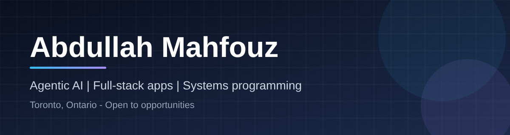
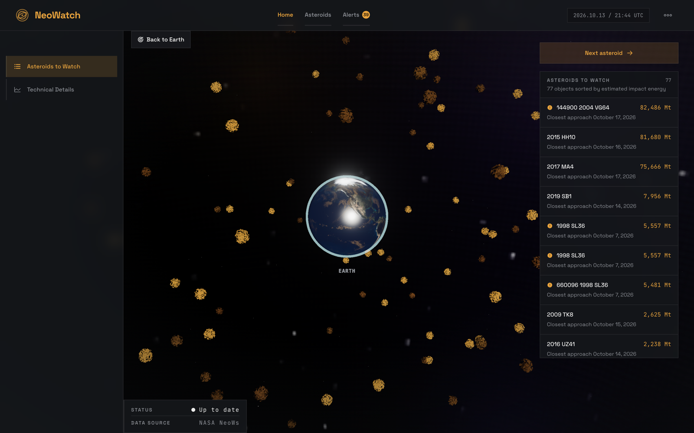
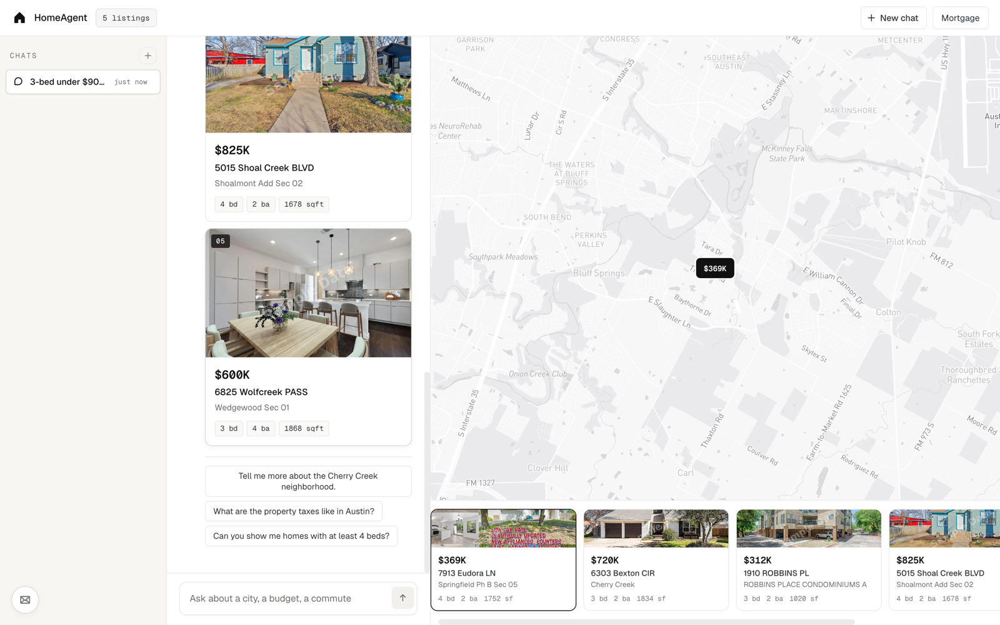
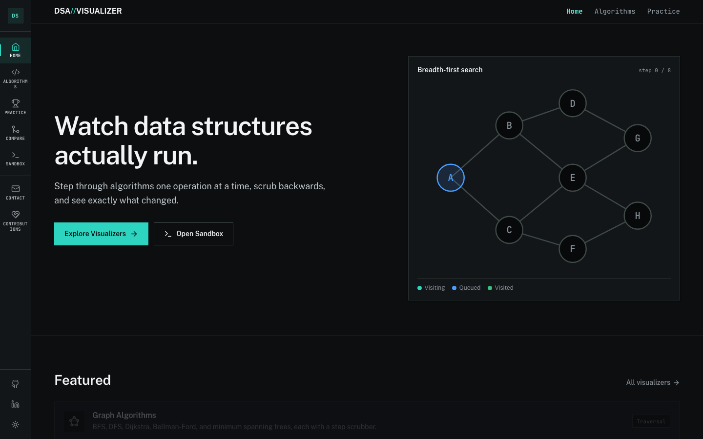
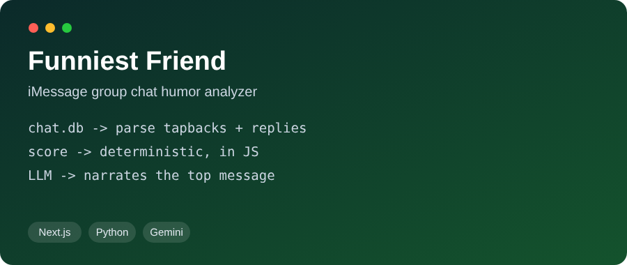
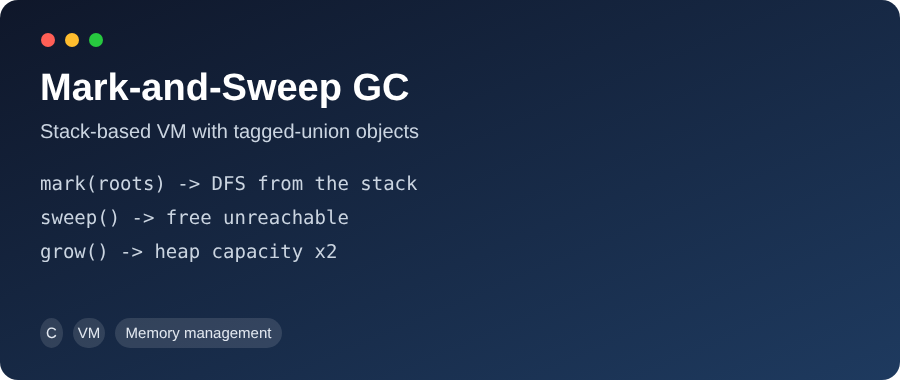
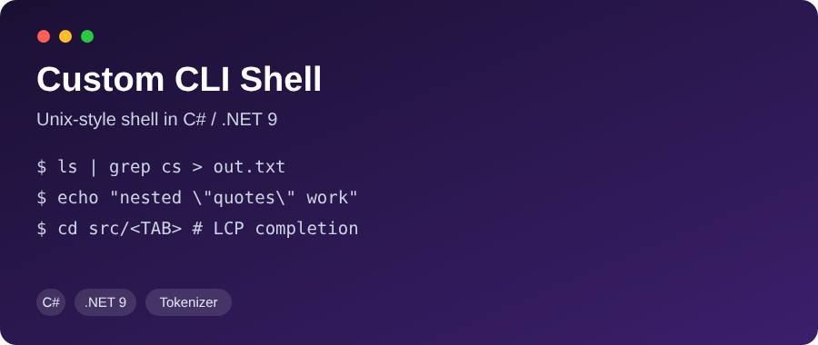

 

[**Featured projects**](#featured-projects) &nbsp;|&nbsp; [**Systems**](#systems-programming) &nbsp;|&nbsp; [**Client work**](#client-work) &nbsp;|&nbsp; [**Stack**](#tech-stack) &nbsp;|&nbsp; [**Contact**](#contact)

---

## About

I just finished my CS degree at Trent University. I live between Peterborough and Toronto, and I'm looking for a full-time role in Toronto.

Lately I've been building apps where an LLM does more than chat. HomeAgent searches real listings and works out the mortgage itself, and my telematics project lets you ask questions about a vehicle's driving data. I also like going low-level: I've written a garbage collector in C and a Unix-style shell in C#.

I mostly work in Python, JavaScript/React, Java with Spring Boot, C# and C.

---

## Featured projects

Click any screenshot to open the live app.

### Telematics Pipeline: driver safety analytics

Real-time ingestion and driver-safety analytics for a vehicle fleet, from raw accelerometer streams to a live dashboard. [**View code**](https://github.com/abdullahmahfouz/Telematics-Ingestion-Driver-Safety-Analytics-Pipeline)

- Rule-based engine flags harsh braking, cornering, and acceleration; events persist to PostgreSQL and roll up into a Redis leaderboard that degrades gracefully when Redis is down
- Two-tier auth: hashed per-device API keys gate ingestion, while operators get short-lived JWTs that the Python AI service validates and forwards instead of using a blanket service credential
- Gemini safety assistant answers plain-English questions about a device's driving data via tool calling; a C# trip simulator replays scripted harsh events for demo data

### NeoWatch: near-Earth object tracker

Live 3D dashboard of near-Earth objects from NASA's public feed, with impact-energy trends and hazard alerts. [**View code**](https://github.com/abdullahmahfouz/Neo-Watch)

- Daily ingest into PostgreSQL with impact-energy snapshots, so you see a trend, not one number
- Real 3D Earth with a custom day/night shader; objects positioned from actual miss distance and velocity
- Redis-cached endpoints, rate limiting, CORS lockdown, secret-gated ingest

### HomeAgent: agentic real estate assistant

Ask for properties in plain English across 8 US states; the agent searches listings and runs mortgage math itself. [**View code**](https://github.com/abdullahmahfouz/homeagent)

- Hand-rolled Gemini function-calling loop (blocking and SSE streaming)
- Session rate limiter plus token-budget guard with persisted state

### DSA Visualizer: interactive data-structures platform

About 15 data structures, 30+ operations, live time/space benchmarking, and a time-travel step scrubber. [**View code**](https://github.com/abdullahmahfouz/dsa-visualizer)

### Funniest Friend: group chat humor analyzer

Decodes iMessage's binary `chat.db` and ranks friends by comedic engagement. Privacy-first: private data never touches git. [**View code**](https://github.com/abdullahmahfouz/Funniest-friend)

---

## Systems programming

<table>
<tr>
<td width="50%" valign="top">

**[Mark-and-Sweep GC](https://github.com/abdullahmahfouz/Mark-Sweep)**
Stack-based VM in C with a tagged-union object model. Reclaims 100% of unreachable memory, including circular references that defeat ref-counting.

</td>
<td width="50%" valign="top">

**[Custom CLI Shell](https://github.com/abdullahmahfouz/Shell)**
Unix-style shell in C# with pipes, redirection, 10+ builtins, a hand-rolled tokenizer, and tab completion.

</td>
</tr>
</table>

---

## Client work

- **Brendon Rodney**: portfolio site for the Paris 2024 Olympic gold medalist (4x100m relay). Zero-dependency static site, 100/100 Lighthouse, $0/month hosting.

---

## Tech stack

**AI and agents:** Gemini API, Claude API, tool use / function calling
**Spoken languages:** English (fluent), Arabic (native)

---

## GitHub stats

---

## Contact

I recently graduated and I'm open to opportunities in Toronto. The fastest way to reach me is [LinkedIn](https://www.linkedin.com/in/abdullah-mahfouz-5188b1306/) or [email](mailto:abdullahmahfouz@trentu.ca).
